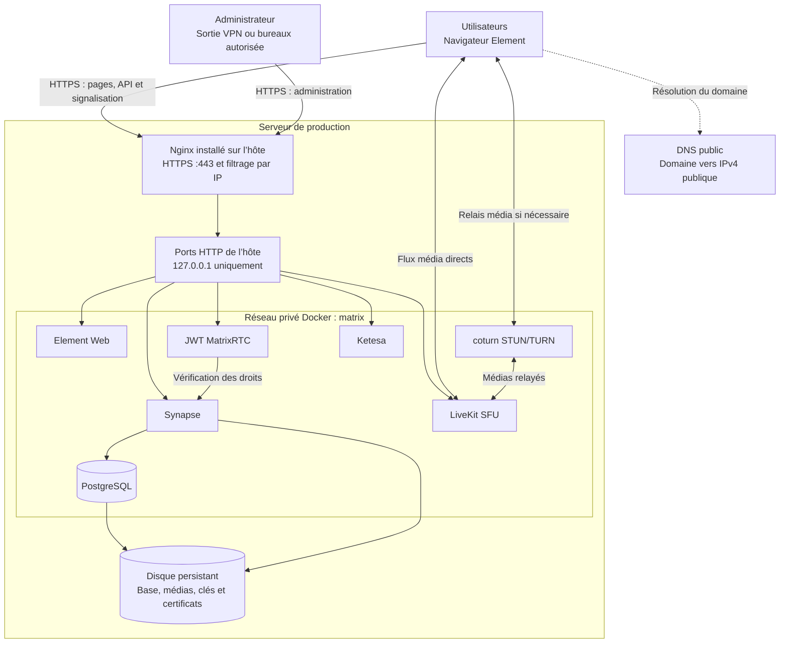
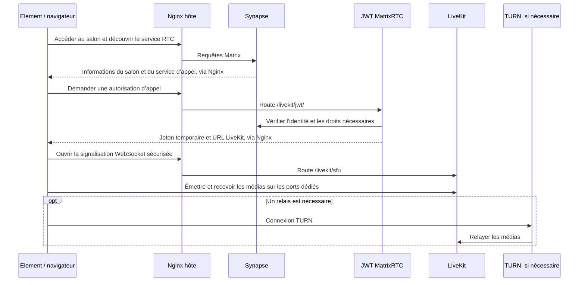

# Plateforme collaborative Element / Matrix

**Présentation fonctionnelle, architecture réseau et principes d’exploitation**

Profil : domaine public unique, Nginx installé sur l’hôte, services applicatifs sous Docker Compose.

Document de référence : 22 octobre 2026.

Cette plateforme permet à une petite équipe d’échanger des messages, de partager des
fichiers et de réaliser des appels audio/vidéo avec partage d’écran. Elle est hébergée
sur un serveur maîtrisé par l’organisation et accessible depuis Internet en HTTPS.
L’accès utilisateur ne nécessite pas Tailscale.

Le présent document explique le fonctionnement de la solution et les responsabilités
de chaque composant. Les commandes d’installation et les paramètres à renseigner
sont détaillés dans les documents suivants.

| Document | Utilité |
|---|---|
| [Procédure de déploiement](DEPLOIEMENT.md) | Installer, configurer, démarrer, tester et sauvegarder la plateforme |
| [Guide du fichier .env](REMPLIR-ENV.md) | Comprendre le domaine, les adresses IP, les ports, les versions et les secrets |
| [Configuration Nginx](configs/nginx/README.md) | Routes et ports à intégrer au vhost géré par l’exploitant |
| [Compose applicatif](compose.yaml) | Définition des sept services Docker, de leurs dépendances et de leurs volumes |

## Accès prévu en production

Le domaine est prérempli avec **`chat.pro-gx.fr`** dans `.env` et `.env.example`.

| Usage | Adresse |
|---|---|
| Interface Element | https://chat.pro-gx.fr/ |
| Administration Ketesa, depuis les IP autorisées | https://chat.pro-gx.fr/admin/ |
| Identifiant d’un utilisateur | `@alice:chat.pro-gx.fr` |

Ce préremplissage ne crée pas le DNS et n’active pas le vhost. Faire pointer le domaine
vers l’IP publique de production et vérifier `SERVER_IP`. La whitelist est gérée
directement dans votre Nginx. Le certificat doit couvrir `chat.pro-gx.fr` ; le chemin proposé
`/etc/letsencrypt/live/chat.pro-gx.fr/` reste à confirmer sur votre serveur.

## 1. Ce que fournit la plateforme

Un utilisateur ouvre l’adresse de la plateforme dans son navigateur, se connecte
avec son compte puis rejoint des **salons** : espaces de discussion consacrés à une
équipe, un projet ou un échange privé. Il peut envoyer des messages, déposer des
photos ou documents et participer à un appel.

L’administrateur dispose d’une console de gestion des comptes et des salons. Cette
console doit être protégée par la whitelist que l’exploitant configure dans Nginx,
puis par l’authentification avec un compte administrateur.

Ce profil vise une équipe de moins de dix utilisateurs. LiveKit est configuré pour
un maximum de dix participants par salle d’appel ; cette limite de configuration
ne garantit pas la capacité réelle du serveur ou de sa connexion Internet.
La plateforme ne fournit pas les fonctions bureautiques complètes d’une suite
collaborative : édition simultanée Office, calendrier ou stockage documentaire avancé.

Les comptes sont locaux. Les inscriptions libres, les accès invités, la fédération
entre serveurs Matrix, Scalar, la connexion par QR code via MAS et les e-mails ne
sont pas activés dans ce profil. La supervision Prometheus/Grafana et le récepteur
Alertmanager sont également extérieurs au périmètre de ce Compose.

## 2. Comprendre les composants

**Matrix est le protocole**, c’est-à-dire l’ensemble des règles utilisées pour les
comptes, les salons et les échanges. **Synapse est le logiciel serveur** qui applique
ces règles. **Element est l’application utilisateur** qui communique avec Synapse.
Ils assurent donc des fonctions différentes, même si le navigateur les atteint par
un seul domaine.

| Composant | Fonction | Mode d’hébergement |
|---|---|---|
| **Nginx** | Reçoit les connexions HTTPS, présente le certificat, choisit le service destinataire et filtre les accès administratifs | Service du système hôte |
| **Element Web** | Fournit l’interface de messagerie et d’appel exécutée dans le navigateur | Conteneur `element` |
| **Synapse** | Gère les comptes, sessions, salons, événements Matrix et accès aux fichiers | Conteneur `synapse` |
| **PostgreSQL** | Conserve les données structurées de Synapse : comptes, sessions, états des salons et événements | Conteneur `postgres` |
| **Service JWT MatrixRTC** | Vérifie les droits liés aux appels et délivre des jetons d’accès temporaires à LiveKit | Conteneur `jwt` |
| **LiveKit** | Reçoit les flux audio, vidéo et écran, puis redistribue les pistes aux participants | Conteneur `livekit` |
| **coturn** | Fournit les fonctions STUN/TURN utiles pour traverser les réseaux et relayer les médias lorsque nécessaire | Conteneur `coturn` |
| **Ketesa** | Fournit l’interface d’administration de Synapse | Conteneur `ketesa`, build prévu pour `/admin` |

Le service JWT est nommé d’après le format de ses jetons : **JSON Web Token**.
Un jeton représente une autorisation temporaire pour un appel ; il ne remplace pas
le compte Matrix et ne contient pas l’historique des messages.

LiveKit fonctionne comme une **SFU** (*Selective Forwarding Unit*) : il redistribue
les pistes média entre participants. STUN aide les équipements à découvrir leur
adresse réseau ; TURN fournit un relais quand la communication média directe vers
le service n’est pas possible. Ces fonctions n’ont pas le rôle d’un serveur web.

L’émission et le renouvellement du certificat sont assurés par le gestionnaire de
certificats du serveur de production. La stack reçoit une copie validée de ses
fichiers ; elle ne contient aucun client d’émission ni timer de renouvellement.

## 3. Architecture générale



Deux types de trafic coexistent :

- **Le trafic web et de signalisation** : pages, messages, fichiers, demandes
  d’autorisation et échanges de contrôle des appels. Il passe par Nginx en HTTPS.
- **Le trafic média** : audio, vidéo et partage d’écran. Il utilise directement les
  ports LiveKit et, si nécessaire, TURN. Il ne passe pas par les routes HTTP de Nginx.

Cette distinction explique pourquoi une interface Element accessible ne suffit pas
à prouver que les appels sont opérationnels.

## 4. Fonctionnement réseau

### 4.1 Un domaine, plusieurs services

Le DNS associe le domaine choisi à l’IP publique du serveur. Tous les accès web
utilisent ensuite le même nom et le même port HTTPS 443. Nginx sélectionne le
service interne selon le chemin demandé dans l’URL.

| Chemin public | Fonction | Destination sur l’hôte, par défaut |
|---|---|---|
| `/` | Interface Element | `127.0.0.1:18080` |
| `/_matrix/client/…` | API de messagerie, comptes et accès client | `127.0.0.1:18008` |
| `/_matrix/media/…` | Routes média Matrix | `127.0.0.1:18008` |
| `/_synapse/client/…` | Routes client propres à Synapse | `127.0.0.1:18008` |
| `/livekit/jwt/…` | Autorisation des appels | `127.0.0.1:18081` |
| `/livekit/sfu` et `/livekit/sfu/…` | Signalisation LiveKit, notamment WebSocket | `127.0.0.1:17880` |
| `/admin/` | Console Ketesa | `127.0.0.1:18082`, accès filtré |
| `/_synapse/admin/…` | API d’administration | `127.0.0.1:18008`, accès filtré |
| `/.well-known/matrix/client` et `/server` | Découverte des adresses Matrix et RTC | Réponse produite par Nginx |

Les documents de découverte indiquent aux clients comment joindre le serveur et
le service d’appels. L’endpoint `/_matrix/federation/v1/openid/userinfo` est également
transmis à Synapse pour la vérification d’identité nécessaire aux appels. Cette
exception n’active pas la fédération générale ; les autres routes de cette famille
sont refusées par le vhost.

Le préfixe public `/livekit/jwt/` est retiré avant transmission au service JWT ;
`/livekit/jwt/healthz` devient donc `/healthz` sur ce service. Le même principe
s’applique au préfixe LiveKit. Pour Ketesa, le chemin `/admin/` est au contraire
conservé : l’image dédiée publie ses fichiers dans ce sous-répertoire.
Les chemins des API Synapse sont, eux, conservés.

### 4.2 Trois espaces d’adressage à distinguer

| Adresse | Signification | Utilisation |
|---|---|---|
| **IP publique** | Adresse joignable depuis Internet | DNS public et IP annoncée aux clients pour les médias |
| **IP privée du serveur**, si présent derrière un routeur | Adresse sur le réseau local de l’organisation | Destination des redirections NAT du routeur |
| **`127.0.0.1`** | Boucle locale : le serveur lui-même | Connexion du Nginx hôte aux services HTTP Docker |

Les services Docker partagent un réseau bridge privé nommé `matrix` dans Compose.
Ils peuvent s’y joindre par leurs noms, par exemple `synapse` contacte `postgres`
pour la base de données. Les adresses IP internes des conteneurs peuvent changer
lorsqu’ils sont recréés ; les noms de services et les ports publiés constituent les
points d’accès stables.

Nginx étant installé sur l’hôte, il utilise les ports `127.0.0.1` publiés par Compose,
et non les noms DNS internes de Docker. Ces ports ne sont pas liés à `0.0.0.0` :
ils ne sont pas destinés à être accessibles depuis une autre machine.
PostgreSQL ne publie aucun port sur l’hôte.

Pour ses accès HTTPS au domaine de la plateforme, le conteneur JWT dispose d’une
entrée `host-gateway` pointant vers l’hôte Docker. Cela permet de revenir vers Nginx
sans dépendre d’un éventuel retour NAT par le routeur. Cette entrée ne modifie pas
le DNS public utilisé par les utilisateurs.

### 4.3 Ports à autoriser depuis Internet

Les valeurs ci-dessous sont celles du modèle fourni. Les valeurs effectives doivent
rester cohérentes entre `.env`, Docker, le pare-feu et les éventuelles règles NAT.

| Protocole | Port ou plage | Destination | Usage |
|---|---|---|---|
| TCP | **443** | Nginx hôte | Accès web, API et signalisation des appels |
| TCP | **80** | Nginx hôte | Redirection HTTP vers HTTPS ; ouverture selon le gestionnaire de certificats externe |
| TCP | **7881** | LiveKit | Transport média TCP |
| UDP | **15000–15100** | LiveKit | Flux média WebRTC |
| UDP et TCP | **3478** | coturn | Accès STUN/TURN |
| TCP | **5349** | coturn | TURN avec TLS |
| UDP | **15200–15300** | coturn | Ports de relais média |

Sur un serveur directement exposé, ces flux sont autorisés dans les pare-feu de
l’hôte et de l’hébergeur. Derrière une box ou un routeur, ils doivent aussi être
redirigés vers la machine qui héberge la stack.

Les ports HTTP locaux **18008, 18080, 18081, 17880 et 18082 ne doivent pas être
ouverts ou redirigés sur Internet**. Les accès d’administration système, comme SSH,
sont à gérer séparément selon la politique de l’organisation.

Docker installe ses propres règles réseau ; un port publié peut contourner certaines
règles UFW classiques. Le filtrage doit être vérifié au niveau réellement traversé
par les paquets, et pas uniquement dans l’affichage d’UFW.

### 4.4 Filtrage de l’administration

Les listes d’IP autorisées sont administrées **directement dans votre Nginx**.
La stack ne contient aucun paramètre de whitelist et ne génère ni n’installe de
vhost. Protéger les deux routes `/admin/` et `/_synapse/admin/` avec la liste des
IP publiques de sortie des bureaux et du VPN professionnel.

La restriction IP et les identifiants administrateur sont complémentaires. Le
filtrage IP n’est pas automatiquement appliqué par Docker ou Synapse ; il dépend
de votre configuration Nginx. Vérifier une réponse 403 depuis une IP non autorisée.

Si un autre proxy se trouve devant Nginx, configurer l’IP réelle avec une liste
stricte de proxies de confiance. En split tunneling, vérifier que le trafic vers
la plateforme emprunte la sortie publique du VPN professionnel.

### 4.5 Coexistence avec les autres applications du serveur

Le serveur de production héberge déjà ces publications TCP :

| Application existante | Port sur l’hôte |
|---|---:|
| MariaDB de Password Pusher | 3306 |
| Password Pusher | 5100 |
| alert-monitor | 8090 |
| Vaultwarden | 8443 |

Les ports Matrix documentés ci-dessus sont distincts de ces quatre valeurs ; aucun
changement de port n’est nécessaire pour cette liste. `RESERVED_TCP_PORTS` vaut
`3306,5100,8090,8443` dans le modèle et déclare ces ports comme indisponibles pour
les publications TCP de cette stack. Le générateur refuse leur réutilisation pour
un backend HTTP, LiveKit TCP ou TURN TCP. Adapter cette liste si les services changent.

Dans `docker ps`, `0.0.0.0:8443->8080/tcp` réserve le **8443 de l’hôte**, tandis que
`80/tcp` ou `443/tcp` affiché sans adresse ni flèche désigne seulement un port du
conteneur. Plusieurs conteneurs peuvent utiliser leur propre port interne 80 ou
8080 ; cela ne réserve pas ces ports sur l’hôte. Les espaces TCP et UDP sont distincts.

Nginx installé sur le serveur conserve ses écoutes 80/443 et reçoit un vhost pour le
nouveau domaine : il n’y a ni second processus proxy ni publication Docker 80/443.
Le DNS de ce vhost doit être distinct de celui des autres sites configurés.
La liste fournie ne recense pas forcément tous les ports de la machine ; confirmer
les écoutes réelles sur le serveur distant avant le démarrage.

## 5. Parcours d’un message ou d’un fichier

1. Le navigateur télécharge l’interface Element depuis Nginx.
2. L’utilisateur se connecte ; Element communique avec l’API Synapse en HTTPS.
3. Synapse vérifie la session et les droits dans le salon concerné.
4. Les événements sont conservés dans PostgreSQL. Les fichiers déposés sont pris
   en charge par Synapse et stockés dans son répertoire de médias.
5. Les clients des autres participants synchronisent les nouveaux événements et
   récupèrent les fichiers auxquels ils ont accès.

Element Web est donc principalement une application distribuée aux navigateurs.
Les données métier ne sont pas stockées dans son conteneur : elles résident côté
Synapse/PostgreSQL et dans les sessions et clés des appareils utilisateurs.

Pour un salon chiffré de bout en bout, le client chiffre le contenu avant de
l’envoyer. Le serveur conserve alors le contenu chiffré et les informations
nécessaires au fonctionnement du service. Le chiffrement des contenus ne supprime
pas les métadonnées techniques de comptes, d’accès ou d’appartenance aux salons.

## 6. Parcours d’un appel audio, vidéo ou écran

La messagerie et les appels partagent l’identité Matrix, mais leurs données ne
suivent pas le même chemin réseau.



Le partage d’écran ajoute une piste média à l’appel. LiveKit distribue les pistes
aux participants ; les images et le son ne transitent pas par PostgreSQL.
Leur disponibilité dépend des clients, des ports ouverts, du débit et de la latence.
Les réseaux n’autorisant que HTTPS sur 443 peuvent encore bloquer les médias ou
TURN sur 5349 : l’accès web seul n’est pas une garantie d’appel réussi.

Les sessions d’appel sont temporaires. Aucun composant d’enregistrement d’appels
n’est déployé dans ce profil. La politique de chiffrement des appels doit être
qualifiée avec les versions de clients retenues ; le certificat HTTPS, à lui seul,
ne constitue pas une preuve de chiffrement de bout en bout de tous les médias.

## 7. Organisation système et cycle de vie

### 7.1 Responsabilités de l’hôte et de Docker

| Niveau | Responsabilités |
|---|---|
| **Système Linux** | Ressources CPU/RAM/disque, interfaces réseau, accès SSH, pare-feu, mises à jour système |
| **Nginx hôte** | Écoute publique 443, certificat HTTPS, routage web, filtrage administratif |
| **Docker Engine** | Exécution des conteneurs, réseau bridge et publication des ports |
| **Docker Compose** | Description des services, dépendances, volumes, redémarrage et contrôles de santé |
| **Scripts du projet** | Génération des configurations, comptes, installation des certificats, sauvegardes et diagnostics |
| **Système / gestionnaire de certificats externe** | Gestion de Nginx et du renouvellement selon les outils de l’organisation |

Tous les services applicatifs utilisent une politique `restart: unless-stopped`.
Un processus arrêté anormalement peut donc être relancé par Docker. Cette politique
ne garantit pas qu’un service est fonctionnel ; un état `unhealthy` ne provoque pas,
à lui seul, un redémarrage automatique par Compose.

Les contrôles de santé et dépendances définis dans Compose limitent les démarrages
dans un ordre incohérent : Synapse attend notamment que PostgreSQL soit disponible.
Nginx est géré séparément par le système et doit être activé après préparation de
son certificat et de son vhost. Les points de contrôle ne remplacent pas une recette
utilisateur complète, notamment pour les appels.

Element Web distribue ses fichiers via un Nginx interne à son image Docker.
Le Compose lui fournit un modèle d’écoute IPv4 uniquement pour fonctionner sur
un hôte sans IPv6. Ce serveur interne n’est pas le reverse proxy de production :
votre vhost et ses whitelists restent entièrement gérés en dehors de la stack.
Le modèle est dans `configs/element/default.conf.template` ; le revoir lors des
mises à jour de l’image Element.

### 7.2 Configuration et génération

Le fichier `.env` est la source des paramètres : domaine, IP média publique, ports,
IP d’administration, images et secrets. Dans ce profil, `SYNAPSE_URL`, `ELEMENT_URL`
et `RTC_URL` ont la même origine HTTPS. Le générateur ajoute les chemins nécessaires.

`scripts/render.py` crée les fichiers privés sous `configs/generated/`, génère les
secrets initialement vides et prépare les droits du volume Synapse, utilisé par
l’UID 991. Les configurations applicatives sont montées en lecture seule dans les
conteneurs. Les JSON de découverte sont fournis sous `configs/generated/nginx/`
pour intégration à votre proxy. Aucun fichier de vhost n’est généré et aucun
script ne modifie ou recharge Nginx.

Une modification contrôlée s’effectue avec `render.py --update`. Ce mode sauvegarde
les paramètres et fichiers générés, conserve les secrets existants et refuse de
renommer l’identité Matrix. Les personnalisations faites directement dans les
fichiers générés peuvent être remplacées ; elles doivent être reportées dans le
modèle ou le générateur avant une régénération.

Le projet n’impose pas de limites CPU/RAM individuelles dans Compose. Les conteneurs
partagent donc les ressources disponibles sur le serveur.

### 7.3 Données persistantes

| Emplacement | Contenu | Importance |
|---|---|---|
| `data/postgres/` | Fichiers de la base PostgreSQL | Comptes, sessions, salons et événements |
| `data/synapse/` | Médias et fichiers persistants Synapse, dont la clé de signature | À conserver avec la base |
| `data/tls/` | Certificat public, clé privée et racines de confiance | HTTPS et TURN TLS |
| `configs/generated/` | Configurations et secrets produits par le générateur | Reproduction cohérente de l’installation |
| `.env` | Paramètres et secrets de l’environnement | À protéger et sauvegarder |
| `backups/` | Dumps, archives, anciennes copies TLS et sauvegardes de configuration | À exporter hors du serveur |
| `/etc/nginx/` | Configuration réellement installée dans le Nginx hôte | Sauvegarde système séparée |

Les données sont stockées dans des répertoires de l’hôte, et non uniquement dans la
couche temporaire des conteneurs. Recréer un conteneur ne recrée donc pas une base
vide si son répertoire persistant est conservé. La suppression de `data/` peut en
revanche détruire l’installation.

## 8. Authentification, chiffrement et certificats

### 8.1 Trois notions différentes

| Notion | Ce qu’elle protège ou vérifie |
|---|---|
| **Compte Matrix et mot de passe** | L’accès au compte et à sa session |
| **Validation de l’appareil / clé de récupération** | L’identité cryptographique et la récupération des clés sur un nouvel appareil |
| **Certificat HTTPS** | L’identité du serveur et le transport chiffré entre client et point d’entrée |

Un nouveau compte est créé par un administrateur avec le script prévu ; les
inscriptions publiques sont désactivées. Les droits d’administration du serveur
et ceux d’un salon sont distincts.

Pour les conversations chiffrées, chaque utilisateur doit préparer la sauvegarde
de ses clés et conserver sa clé de récupération. Elle permet de valider un nouvel
appareil sans disposer d’une ancienne session. Une réinitialisation du mot de passe
ou une sauvegarde serveur ne remplace pas cette clé personnelle.

HTTPS se termine dans Nginx. Les échanges HTTP entre Nginx et les services locaux
restent à l’intérieur de l’hôte ; les communications interservices utilisent le
réseau Docker. Cela ne remplace ni la protection du serveur ni celle des sauvegardes.
Le chiffrement des disques n’est pas mis en place par ce projet.

### 8.2 Gestion du certificat public

Le certificat est **émis et renouvelé par les outils du serveur de production**,
indépendamment de Docker et du fournisseur DNS. La stack ne demande aucun token
DNS et ne gère pas l’émission elle-même.

Après la première émission puis après chaque renouvellement, un hook appelle :

```bash
python3 scripts/tls.py install --cert /chemin/fullchain.pem --key /chemin/privkey.pem
```

Le script vérifie la chaîne publique, le domaine, la validité et la correspondance
clé/certificat, puis installe les copies dans `data/tls` pour coturn et les racines
de confiance de JWT. Nginx conserve les chemins de certificat et son cycle de
rechargement propres. Renouveler les sources sans lancer le hook laisserait TURN
avec l’ancien certificat.

Si le contenu change, les anciennes copies sont sauvegardées sous `backups/`.
Le script redémarre TURN si le certificat a changé et recrée JWT si les racines
de confiance ont changé. Il ne teste, ne recharge et ne modifie pas Nginx.
Un redémarrage TURN peut perturber les appels qui utilisent ce relais.
Si l’activation échoue, la même commande peut être relancée : une activation en attente
est mémorisée sous `data/`. Réinstaller des fichiers déjà actifs et identiques ne
redémarre pas les services.

Le gestionnaire externe conserve la responsabilité du renouvellement, de sa
planification et des alertes d’échec. Les outils nécessaires, les éventuels secrets
DNS et l’ouverture requise du port 80 relèvent de sa configuration. Voir la procédure
pour un exemple de hook Certbot, à adapter à l’outil réellement utilisé. Le
[modèle de hook](configs/certificates/deploy-hook.sh.example) est fourni dans le projet.

## 9. Exploitation quotidienne

Les commandes ci-dessous s’exécutent en root depuis le dossier du projet :

```bash
cd /core/docker/Element_Matrix/matric-poc-prod

# État, journaux et consommation des conteneurs.
docker compose ps
docker compose logs --tail=100 synapse jwt livekit coturn ketesa
docker stats $(docker compose ps -q)

# Contrôles fonctionnels HTTP et chaîne d’autorisation RTC.
python3 scripts/check-endpoints.py
python3 scripts/test-rtc.py

# Création interactive des comptes.
bash scripts/create-user.sh --admin
bash scripts/create-user.sh

# Sauvegarde cohérente avec interruption temporaire de Synapse/JWT.
bash scripts/backup.sh
```

Les journaux des conteneurs sont configurés en `json-file` avec rotation : 10 Mo par
fichier, trois fichiers par service. Les journaux Nginx appartiennent à l’hôte et
nécessitent leur propre rotation. Les fichiers de logs et de diagnostic peuvent
contenir des informations sensibles ; limiter leur accès et vérifier leur contenu
avant partage.

La supervision doit couvrir l’espace disque, la croissance des médias et de la
base, CPU/RAM, les erreurs HTTP, l’expiration TLS, les services indisponibles et la
réussite des sauvegardes. `docker stats` mesure les conteneurs, pas Nginx ni l’OS.
Un état sain des conteneurs ne valide pas le routage public ou la qualité des appels.
Prévoir un canal d’alerte indépendant si ce serveur est indisponible.

| Symptôme | Vérifications prioritaires |
|---|---|
| Site inaccessible | DNS, IP publique, filtrage/NAT 443, Nginx et certificat |
| Réponse 502 | Service Docker arrêté, mauvais port local ou indisponibilité pendant maintenance |
| `/admin/` renvoie 403 | IP publique de sortie, VPN et whitelist de votre vhost Nginx |
| Connexion réussie mais nouvel appareil non vérifié | Ancienne session ou clé de récupération utilisateur |
| Appel établi sans son/vidéo | IP annoncée, ports média, filtrage UDP/TURN et réseau du participant |
| Certificat renouvelé mais ancien TLS encore servi | Certificat et rechargement du proxy externe ; copies TLS de TURN et résultat du hook |

## 10. Sauvegarde, restauration et disponibilité

Le script de sauvegarde suspend temporairement Synapse et JWT pour figer les
écritures, crée un dump logique PostgreSQL et archive les médias, clés, paramètres
et copies TLS. Un verrou évite une installation de certificat simultanée à la
sauvegarde. Le script calcule des empreintes et relance les services. Nginx hôte reste
actif pour préserver ses autres sites, mais les API Matrix sont temporairement
indisponibles pendant cette opération.

Le dump constitue la sauvegarde de référence pour PostgreSQL ; copier son répertoire
vivant comme une simple arborescence ne remplace pas une sauvegarde cohérente.
Les archives du projet n’incluent pas automatiquement `/etc/nginx` ni l’ensemble
d’un gestionnaire de certificats externe : ces éléments doivent être sauvegardés
par l’exploitation du système.

Une sauvegarde stockée seulement sur le serveur ne protège pas d’une perte de ce
serveur. Les archives doivent être protégées, exportées sur un stockage distinct
et restaurées régulièrement dans un environnement isolé. La procédure de restauration
est décrite dans [DEPLOIEMENT.md](DEPLOIEMENT.md).

Cette architecture utilise un seul hôte et des instances uniques des services.
Elle n’assure pas de haute disponibilité : une panne de l’hôte ou du disque peut
interrompre toute la plateforme. Les objectifs de reprise et la durée acceptable
d’indisponibilité dépendent des sauvegardes, de leur fréquence et de la capacité
à reconstruire le serveur. Ils doivent être définis par l’organisation.

## 11. Dimensionnement et limites de validation

Pour le périmètre initial, réserver à la **stack applicative** :

| Ressource | Budget de départ |
|---|---|
| CPU | 2 vCPU |
| RAM | 2 Go |
| Stockage | 30 Go SSD, à ajuster avec la croissance des médias |

Ajouter les besoins de Linux, Nginx, des autres services et des sauvegardes pour
dimensionner la machine complète. Ce budget n’est pas une réservation imposée par
Compose et ne vaut pas engagement de performance.

Les appels de groupe dépendent fortement du débit réseau, du nombre de pistes,
des caméras, du partage d’écran et des relais TURN utilisés. Le stockage dépend
principalement de la quantité de fichiers conservés et de la politique de rétention.
Les versions d’images sont épinglées dans `.env.example` pour la reproductibilité ;
leurs mises à jour et avis de sécurité doivent être suivis par l’exploitant.

Les configurations applicatives, les ports loopback, les secrets et la protection
de l’identité peuvent être validés indépendamment du proxy. La stack ne valide pas
votre vhost externe : sa syntaxe, ses whitelists, les routes et la recette publique
restent à vérifier avec votre configuration Nginx de production.

## 12. Références

- [Documentation Synapse](https://element-hq.github.io/synapse/latest/usage/configuration/config_documentation.html) : configuration du serveur Matrix.
- [Documentation Nginx](https://nginx.org/en/docs/) : reverse proxy, TLS et contrôle d’accès.
- [Ports LiveKit](https://docs.livekit.io/transport/self-hosting/ports-firewall/) : séparation entre signalisation et médias.
- [Documentation Ketesa](https://github.com/etkecc/ketesa) : administration et déploiement sous `/admin`.
- [Récupération des clés Element](https://docs.element.io/latest/element-support/device-verification/how-to-ensure-you-have-a-recovery-key/) : continuité de l’identité cryptographique.
- [Docker et filtrage réseau](https://docs.docker.com/engine/network/packet-filtering-firewalls/) : interaction entre ports publiés et pare-feu.
